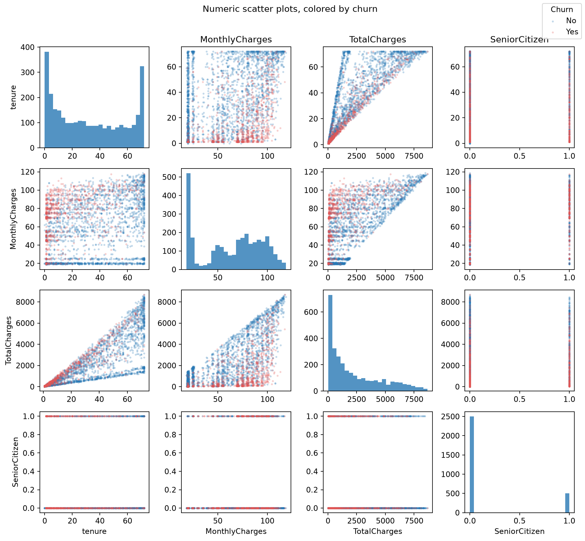
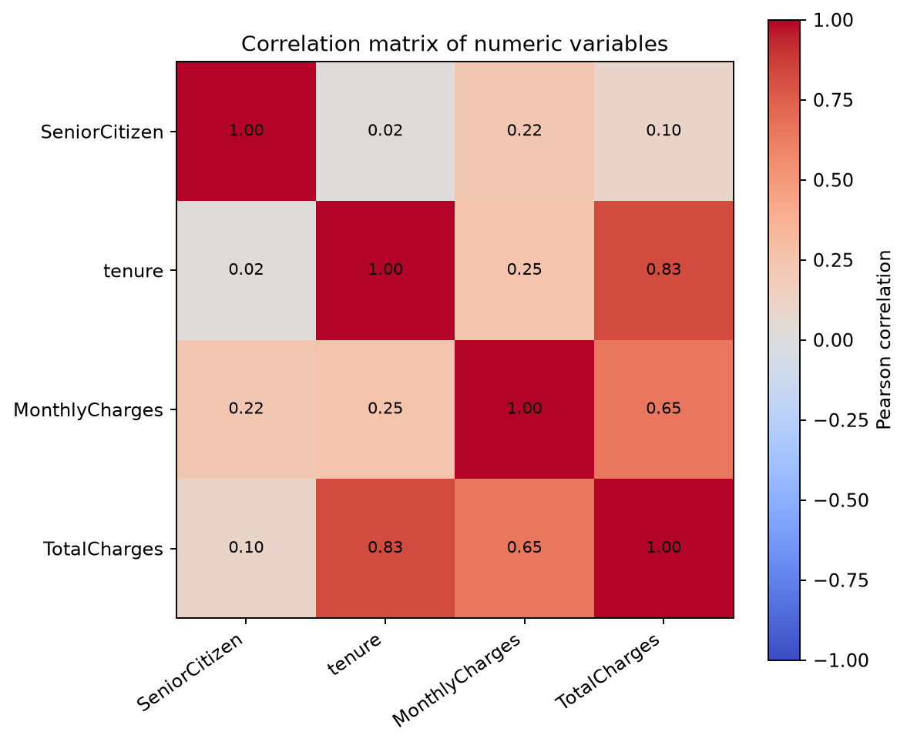
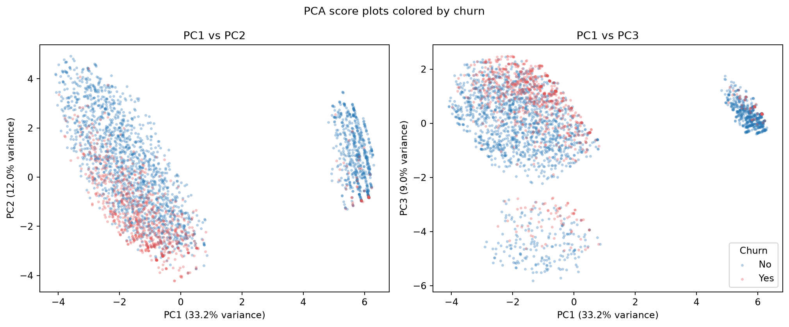
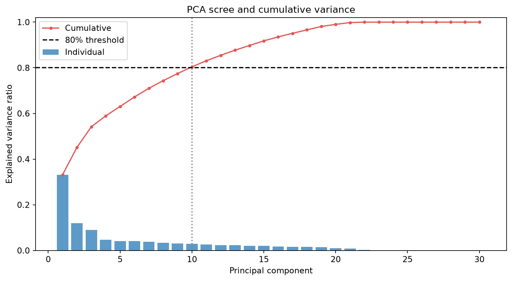
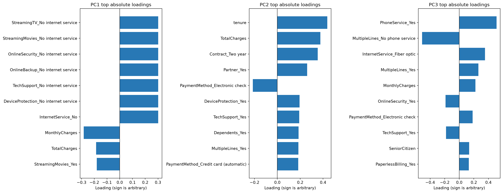

# Principal Component Analysis of Telco Customer Churn

## Data and method

The assignment refers to `CST-570-RS-WAFn-UseC-Telco-Customer-Churn.xlsx`, but
that workbook was not supplied with this repository and the referenced Windows
file path is not accessible here. The numerical results and figures below use the
public WA_Fn-UseC Telco churn CSV cited in the references. It contains 7,043
customers and 21 columns. The supplied analysis script accepts either CSV or Excel;
run it on the assignment workbook to verify whether its contents match this public
version exactly.

The customer ID is not an analytical feature, and the `Churn` outcome is excluded
from PCA to avoid target leakage. Churn is used only to color the scatter and score
plots. The 19 remaining predictors become 30 encoded features: numeric predictors
are median-imputed and standardized; categorical predictors are most-frequent
imputed, one-hot encoded with a reference level dropped, and standardized.
`TotalCharges` blanks in zero-tenure records are interpreted as zero; any other
missing values are imputed by the stated rules. PCA is performed on the resulting
standardized features. This scaling gives each encoded feature unit variance,
which is important because PCA is sensitive to feature scale.

## 1. Scatter plots and correlation coefficients



The scatter matrix shows the numeric predictors (`tenure`, `TotalCharges`,
`MonthlyCharges`, and `SeniorCitizen`); the correlation heat map and coefficients
are shown below. `SeniorCitizen` is binary, so its Pearson correlations are
point-biserial associations.



| Numeric variable pair | Pearson *r* |
| --- | ---: |
| `tenure` – `TotalCharges` | 0.826 |
| `MonthlyCharges` – `TotalCharges` | 0.651 |
| `tenure` – `MonthlyCharges` | 0.248 |
| `SeniorCitizen` – `MonthlyCharges` | 0.220 |
| `SeniorCitizen` – `TotalCharges` | 0.103 |
| `SeniorCitizen` – `tenure` | 0.017 |

The strong positive tenure–total-charge relationship is visible as an upward
trend: customers with longer tenure generally have accumulated higher charges.
Monthly charges also rise with total charges (*r* = 0.651), while the association
between monthly charges and tenure is weaker (*r* = 0.248). Senior-citizen status
has little linear association with tenure or total charges in this matrix.
Correlation describes linear association, not causation, and does not measure
relationships among categorical variables. Those categorical predictors are
included in PCA after encoding.

## 2. PCA and score plots



The plots show each customer's projection onto the first two and first/third
principal-component axes. Each point is a customer; color indicates the known
churn label, which was not used to calculate the components. These low-dimensional
views are useful for seeing broad structure, but they preserve less than half of
the total variance across the full encoded feature set.

## 3. Number of principal components



The first component explains 33.18% of the variance, the second 11.98%, and the
third 9.02%. The first two together explain 45.16%. Nine components explain
77.47%, and ten explain 80.42%; therefore, **ten components** are retained under
the stated 80% cumulative-variance rule. This is a practical compression choice,
not a universal cutoff: two components are adequate for a 2-D visualization, but
not for retaining most of the dataset's variation.

## 4. Variables represented by the components and relationship to correlation



Loadings describe how each standardized/encoded feature contributes to a
component; larger absolute values indicate stronger contributions, and the sign
of an entire component is arbitrary. The plot shows the largest absolute
loadings for the first three components. The table lists the six largest absolute
loadings for each of the ten retained components; the complete signed loading
matrix is in `report_assets/pca_loadings.csv`.

| Component | Six largest absolute loadings (signed) | Interpretation |
| --- | --- | --- |
| PC1 (33.18%) | InternetService_No (+0.302); OnlineSecurity_No internet service (+0.302); OnlineBackup_No internet service (+0.302); DeviceProtection_No internet service (+0.302); TechSupport_No internet service (+0.302); StreamingTV_No internet service (+0.302) | Primarily contrasts customers without internet service against internet access/service-use features, including monthly charges. |
| PC2 (11.98%) | tenure (+0.438); TotalCharges (+0.376); Contract_Two year (+0.353); Partner_Yes (+0.261); PaymentMethod_Electronic check (−0.214); DeviceProtection_Yes (+0.194) | A tenure/accumulated charges and longer-contract axis, with additional household and payment contrasts. |
| PC3 (9.02%) | PhoneService_Yes (+0.511); MultipleLines_No phone service (−0.511); InternetService_Fiber optic (+0.353); MultipleLines_Yes (+0.263); MonthlyCharges (+0.222); OnlineSecurity_Yes (−0.189) | Mainly separates phone-service status, with fiber and higher monthly charges contributing. |
| PC4 (4.75%) | PaymentMethod_Mailed check (+0.376); PhoneService_Yes (+0.355); MultipleLines_No phone service (−0.355); PaymentMethod_Electronic check (−0.345); SeniorCitizen (−0.331); OnlineSecurity_Yes (+0.250) | A mixed payment-method, phone-service, and age-status contrast. |
| PC5 (4.15%) | Dependents_Yes (+0.580); Partner_Yes (+0.503); PaymentMethod_Credit card (automatic) (−0.362); Contract_One year (−0.339); PaymentMethod_Electronic check (+0.271); Contract_Two year (+0.162) | Mostly household composition with contract/payment contrasts. |
| PC6 (4.12%) | Contract_One year (+0.752); Contract_Two year (−0.481); Dependents_Yes (+0.246); Partner_Yes (+0.238); PaymentMethod_Credit card (automatic) (−0.149); PaymentMethod_Electronic check (+0.118) | Primarily distinguishes one-year from two-year contract customers. |
| PC7 (3.81%) | PaymentMethod_Credit card (automatic) (+0.662); PaymentMethod_Mailed check (−0.471); StreamingMovies_Yes (−0.245); StreamingTV_Yes (−0.242); Dependents_Yes (+0.221); Partner_Yes (+0.215) | A payment-method contrast with smaller streaming and household contributions. |
| PC8 (3.34%) | gender_Male (+0.995); SeniorCitizen (+0.037); PaymentMethod_Mailed check (+0.034); OnlineSecurity_Yes (−0.033); PaperlessBilling_Yes (−0.031); Contract_One year (−0.029) | Nearly an isolated gender indicator in this standardized encoded feature space. |
| PC9 (3.12%) | SeniorCitizen (+0.691); StreamingTV_Yes (−0.306); StreamingMovies_Yes (−0.279); PaymentMethod_Mailed check (+0.233); OnlineBackup_Yes (+0.222); Partner_Yes (+0.204) | Mainly senior-citizen status versus media-service and household indicators. |
| PC10 (2.95%) | PaymentMethod_Electronic check (+0.501); PaymentMethod_Mailed check (−0.441); PaperlessBilling_Yes (−0.409); OnlineSecurity_Yes (+0.298); StreamingTV_Yes (−0.207); PaymentMethod_Credit card (automatic) (−0.196) | A payment-method and paperless-billing contrast. |

The numeric correlation matrix is consistent with PC2's positive tenure and
`TotalCharges` loadings: those two original numeric features are strongly
correlated (*r* = 0.826), and `MonthlyCharges` is also positively associated with
`TotalCharges` (*r* = 0.651). PCA combines correlated variables into axes rather
than repeating them as separate dimensions. PC1 and several later components
also capture categorical contrasts that cannot appear in the numeric-only
correlation matrix. Encoded variable names refer to non-reference categories;
for example, a `Yes` loading is relative to the category dropped by the encoder.

## 5. Outliers

The PC1–PC2 scores were screened using squared distance standardized by each
component's variance. Records above the **empirical 99th percentile** of that
distance are flagged for review: 71 customers (1.01%) meet the cutoff. These
points occupy the tails of the score distribution and can represent unusual
combinations of service, contract, or tenure characteristics. This is a
screening convention that selects approximately the top 1% by construction; it
does **not** establish that these are erroneous observations or statistically
abnormal under a validated population model. They should be reviewed against
source records before being removed or corrected.

## Reproduction and limitations

Install dependencies and run:

```bash
python -m pip install -r requirements.txt
python analyze_telco_churn.py path/to/Telco-Customer-Churn.xlsx --output-dir report_assets
```

The script also accepts `.csv` and writes the numeric correlation matrix, full
retained-component loading matrix, explained-variance table, summary, and all
figures to the output directory. The conclusions depend on the public CSV
version and the encoding/scaling choices above. PCA is descriptive and
unsupervised; it is not a churn-prediction model and does not establish causal
drivers of churn.

## References

- Jolliffe, I. T., & Cadima, J. (2016). Principal component analysis: A review
  and recent developments. *Philosophical Transactions of the Royal Society A:
  Mathematical, Physical and Engineering Sciences, 374*(2065), 20150202.
  https://doi.org/10.1098/rsta.2015.0202
- Scikit-learn developers. (n.d.). *PCA*. Scikit-learn user guide.
  https://scikit-learn.org/stable/modules/decomposition.html#pca
- Treselle Systems. (n.d.). *WA_Fn-UseC Telco customer churn data*
  [Data set]. GitHub.
  https://github.com/treselle-systems/customer_churn_analysis/blob/master/WA_Fn-UseC_-Telco-Customer-Churn.csv
